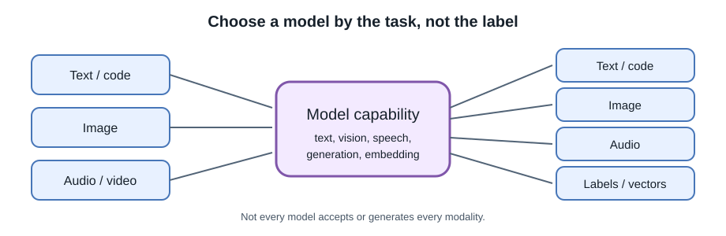
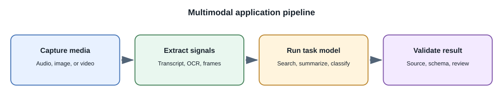

# Model Types and Capabilities

## Introduction

"AI model" describes many systems with different input and output types.
Before selecting a provider or architecture, describe the task: what
information goes in, what should come out, how errors are handled, and
whether a person must review the result.

## Common model categories

| Model category | Typical input | Typical output | Example use |
|---|---|---|---|
| Chat and language generation | Text and conversation context | Text, structured fields, or tool-call requests | Assistant, drafting, Q&A |
| Reasoning-oriented language model | Text or structured task | Multi-step answer or plan | Complex analysis with verification; cost and latency may be higher |
| Code model | Source code, tests, instructions | Code completion, explanation, or patch suggestion | Developer assistance; generated code still needs review and tests |
| Embedding model | Text, image, or other supported content | Numeric vector | Semantic search, clustering, retrieval |
| Classifier | Example and candidate labels | Category or score | Routing support tickets or detecting content categories |
| Image generation model | Text prompt, sometimes reference images | Generated or edited image | Concept art, assets, design exploration |
| Speech model | Audio or text | Transcription, translation, or generated speech | Voice interface, captions, audio summaries |
| Video model | Text, images, or video, depending on model | Video, summary, or extracted description | Creative generation, scene search, summarization |
| Multimodal model | Multiple modalities such as text and images | Text or other supported outputs | Ask questions about a chart or image |
| Recommendation/ranking model | User, item, and context features | Ranking or recommendation scores | Product or media discovery |
| OCR / document understanding | Page image or document file | Extracted text, fields, or layout | Invoice review and searchable scans |
| Anomaly detector | Events or measurements | Unusualness score or flag | Operations review and equipment monitoring |

Categories overlap. A multimodal model might accept images and audio; a
single product can combine several specialized models in one workflow.
Capabilities and limits vary by model version and deployment.

## Generative and predictive models

**Generative models** produce content such as text, an image, or audio.
**Discriminative models** estimate labels, scores, or distinctions for
inputs. These are broad modeling categories; real model designs can blur
the line.

Choose deterministic code or a conventional model when it is easier to
validate than free-form generation. For example, calculate a tax total with
application code rather than asking a chatbot to perform arithmetic that
must be exact.

## Open weights, source, and hosted access

- **Hosted model/API:** a provider runs the model and exposes an interface.
  The model's weights may not be available to the customer.
- **Open-weight model:** weights are available under a license for
  permitted use, but training data, code, or full reproducibility may not be
  available.
- **Open-source AI system:** the term can mean different things; inspect
  the license, weights, data and documentation available, and usage
  restrictions instead of assuming every component is open.
- **Commercial product:** may combine models, tools, safety systems,
  retrieval, and proprietary infrastructure.

Model access and license terms change. Confirm the current license, allowed
use, retention behavior, and deployment terms for the exact model and
version.

## Public examples

Examples of public AI products and model platforms include OpenAI's
ChatGPT/API offerings, Google's Gemini products and APIs, Anthropic's Claude
products and API, GitHub Copilot for coding assistance, Adobe Firefly for
creative workflows, and Meta's Llama model family. These are examples of
different product and provider categories, not an endorsement, a complete
market list, or a claim that every product uses one model for every feature.

Public product names and capabilities evolve. Prefer current official
documentation when selecting a model for a project.

## How a full-stack application may combine models

A study-notes app could use:

1. A speech-to-text model to transcribe a lecture.
2. A language model to draft a summary.
3. An embedding model to index notes for semantic search.
4. A language model with retrieved passages to answer a question with
   citations.
5. Application code to enforce access permissions and store the user's
   notes.

A shopping application might instead use a ranking model to sort eligible
items, an image model to describe product photos, and ordinary business
rules to filter unavailable items. Eligibility and price calculations
should remain deterministic backend operations.

Each step has a distinct contract and should be evaluated separately.

## Model routing: selecting a model for a task

**Model routing** is the application-level decision about which model or
processing path should handle a request. A system may route an image
question to a vision-capable model, a semantic-search query to an embedding
model, or a simple deterministic calculation to ordinary code.

Routing can be implemented with:

- **Explicit application rules:** choose a model from a known feature,
  input type, account setting, or user selection. This is predictable and
  easy to inspect.
- **A lightweight classifier:** classify the task into a small set of
  allowed routes. The backend still validates the route and permissions.
- **A model-based router:** ask a model to select from a bounded set of
  tools or model choices. This can handle less structured requests, but
  adds another model call and can choose incorrectly.

An example policy might send ordinary note questions to a lower-cost text
model, image questions only to a model that supports images, and questions
requiring current private information through an authorized retrieval
workflow. A request to calculate a total should normally use application
code rather than a language model.

Keep the router separate from authorization. A route is a technical choice,
not permission to read a user's data or perform an action. Define allowed
routes on the server, validate the selected model's actual input and output
capabilities, and provide a safe fallback when no route fits. Compare the
routed result with a fixed baseline for task quality, latency, and cost;
otherwise routing can add complexity without improving the experience.

Do not route solely by a model's name, size, or marketing category.
Provider capabilities, limits, and model versions change, so keep model
configuration replaceable and verify the current provider documentation.

## Developer perspective

Choose based on task quality, latency, cost, availability, data policy,
language or modality coverage, output constraints, and operational
requirements. Use task-specific tests instead of comparing model names or
parameter counts alone.

## Common misconceptions

- A chatbot, a model, and an AI product are not the same thing.
- "Open weight" does not automatically mean unrestricted commercial use.
- A coding model can generate plausible but insecure or incorrect code.
- Image, audio, video, and text models have different input, output, and
  evaluation requirements.
- A model router does not grant access to data or tools; authorization
  remains an application responsibility.

## Further learning

- [OpenAI API documentation](https://platform.openai.com/docs/overview)
- [Google Gemini API documentation](https://ai.google.dev/gemini-api/docs)
- [Anthropic documentation](https://docs.anthropic.com/)
- [GitHub Copilot documentation](https://docs.github.com/en/copilot)
- [Adobe Firefly](https://www.adobe.com/products/firefly.html)
- [Meta Llama](https://www.llama.com/)
