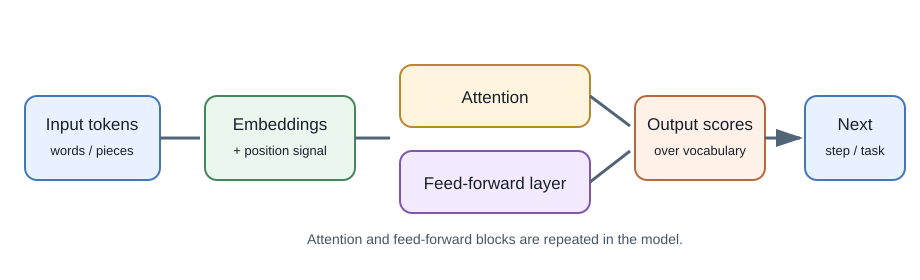
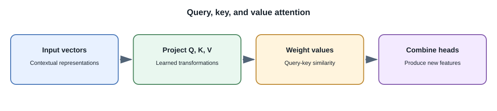

# Neural Networks and Transformers

## Introduction

A **neural network** is a mathematical model made of connected operations
with parameters adjusted during training. A **transformer** is a neural
network architecture that uses attention to process relationships among
items in a sequence or other structured input. Transformers underpin many
modern language models and are also used for images, audio, video, and
multimodal tasks.

## Neural-network basics

A network receives numeric inputs, applies parameterized operations and
nonlinear transformations through layers, then produces outputs. During
training, an objective (loss) measures how far predictions are from training
targets. An optimization algorithm calculates how to adjust parameters to
reduce that loss.

- **Forward pass:** compute a model output from an input.
- **Loss:** numeric training objective measuring some prediction error.
- **Backpropagation:** calculate how the loss changes with model parameters.
- **Optimizer:** update parameters using those calculated gradients.
- **Epoch:** one pass through the training dataset, in training setups that
  use epochs.

Inference uses the learned parameters to produce outputs; it usually does
not update them.

## Attention and the transformer idea

Attention lets a model compute which parts of an input are relevant to
processing another part. In a language sequence, the representation for a
token can incorporate information from other tokens. **Self-attention**
computes these relationships within the same sequence.

The transformer architecture commonly combines attention with feed-forward
layers, residual connections, normalization, and positional information.
Details differ across model architectures. The key idea is that attention
helps model long-range relationships and can be parallelized during training
more readily than recurrent sequence processing.

In a simplified self-attention operation, each input representation is
projected into a **query (Q)**, **key (K)**, and **value (V)**. Similarity
between a query and keys determines weights over the values. Multiple
**attention heads** learn different relationships in parallel and their
results are combined. This helps the model contextualize tokens, but the
weights are not a human-readable explanation of why an answer is true.

### Encoder, decoder, and encoder-decoder patterns

| Pattern | Broad behavior | Common use |
|---|---|---|
| Encoder-style | Build contextual representations of the input | Classification, search embeddings, extraction |
| Decoder-style | Generate an output sequence one token at a time | Chat, completion, code generation |
| Encoder-decoder | Encode an input and generate a related output | Translation, summarization, speech or text transformations |

These are useful architectural families, not a complete list of current
designs. Some systems combine components or use other architectures.

Vision transformers commonly split an image into patches and process them
as a sequence of representations. Audio models may use frames, learned
tokens, or other encodings. Their inputs and training objectives are
specialized; a text-only decoder cannot automatically process raw media.

## From text to model input

Text is split into **tokens**, which are converted to numeric identifiers
and then to learned **embeddings** (vectors). The model processes these
representations and produces output scores. A decoder-style language model
selects or samples a next token, appends it to the context, and repeats
until a stopping condition is met.

The output is generated token by token. This is why a long response takes
time, why context limits matter, and why the model can produce a plausible
continuation that is not factually grounded.

## Why use transformers?

Attention gives models a flexible way to relate different positions in an
input, and large-scale training can produce representations useful across
many tasks. Trade-offs include substantial compute and memory requirements,
quadratic attention cost in some common designs with sequence length,
latency for autoregressive generation, and difficult-to-predict behavior.
Modern systems use optimizations and architectures that change these costs;
do not assume one cost profile fits every model.

## Full-stack developer perspective

You generally call an inference endpoint rather than implement
backpropagation or attention yourself. Knowing the high-level flow helps
explain prompt length, context windows, streaming responses, embeddings, and
latency. For a production feature, treat the model version and its input
format as dependencies that can change.

## Common misconceptions

- Attention is a model operation, not human attention or an explicit source
  citation.
- A transformer is an architecture, not a single model or product.
- An embedding is a learned numeric representation, not a guaranteed
  definition of meaning.
- Neural networks do not retrieve exact training examples on command like a
  database query.

## Further learning

- [Attention Is All You Need](https://arxiv.org/abs/1706.03762)
- [The Illustrated Transformer](https://jalammar.github.io/illustrated-transformer/)
- [Hugging Face: How do Transformers work?](https://huggingface.co/learn/llm-course/chapter1/4)
