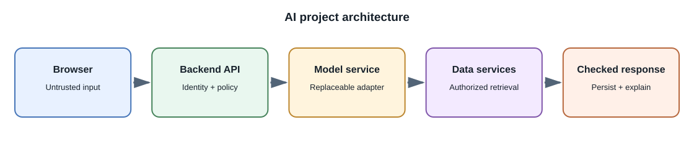
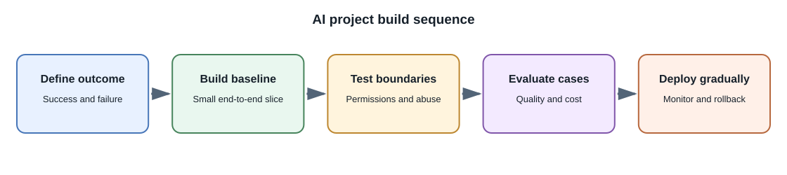

# AI Projects

Build these in order so each project adds one capability while reusing
ordinary full-stack engineering practices.

## 1. Hosted-model API playground

Build a backend endpoint that accepts a user prompt, validates its length,
calls a hosted model, and returns a bounded response.

- Keep the API key on the server.
- Add authentication, rate limiting, timeout handling, and usage tracking.
- Show loading, cancellation, error, and retry states in the UI.
- Test that an invalid request never reaches the provider.
- Do not log the key or unnecessary prompt content.

Practices [Hosted Model APIs](hosted-model-apis.md),
[Building AI Features](building-ai-applications.md), and
[Deployment, Cost, and Performance](deployment-cost-and-performance.md).

## 2. Local-model comparison

Run one small model locally and compare it with a permitted hosted model on
the same set of fictional tasks. Record quality, latency, context limits,
hardware use, and operational work. Keep the sample data non-sensitive.

Practices [Model Types](model-types-and-capabilities.md) and
[Running Models Locally](local-models.md).

## 3. Structured support-ticket triage

Create a small set of fictional tickets and allowed categories. Ask a model
for structured output, validate it on the backend, and route uncertain cases
to a human review screen.

- Test malformed, ambiguous, and out-of-scope messages.
- Do not let the model execute ticket changes.
- Compare against a simple keyword or rules baseline.

Practices [Prompting and Structured Output](prompting-and-structured-output.md)
and [Evaluation and Monitoring](evaluation-and-monitoring.md).

## 4. Searchable study notes with RAG

Let a signed-in user add notes, index chunks, ask questions, and open cited
source passages.

- Enforce note ownership before indexing and retrieval.
- Store source IDs and locations with each chunk.
- Test that one user's query never retrieves another user's notes.
- Test deletion and re-indexing when a note changes.
- Say when no useful source was found instead of inventing an answer.

Practices [Embeddings and Vector Search](embeddings-and-vector-search.md),
[RAG](retrieval-augmented-generation.md), and
[Security and Responsible AI](security-privacy-and-responsible-ai.md).

## 5. Fine-tune a narrow behavior (optional)

Only after establishing a baseline, use a small permitted dataset and a
supported model to explore fine-tuning. Compare it with prompting on the
same held-out examples. Document the model, data, terms, cost, and
regressions. Do not upload personal or confidential data without approval.

Practices [Fine-Tuning](fine-tuning.md) and
[Training Models](training-models.md).

## Suggested project quality checklist

- Define the user problem and a measurable success criterion.
- Keep authorization, validation, and side effects in ordinary backend
  code.
- Set input, output, rate, time, and cost limits.
- Add tests for errors, retries, permissions, and sensitive data.
- Evaluate representative successes and failures before deployment.
- Explain generated content and uncertainty to users.
- Provide deletion and correction paths for stored or derived data.
- Document which model and prompt versions were used.
