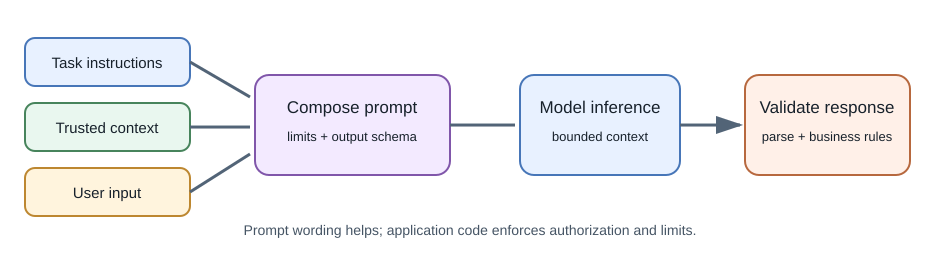
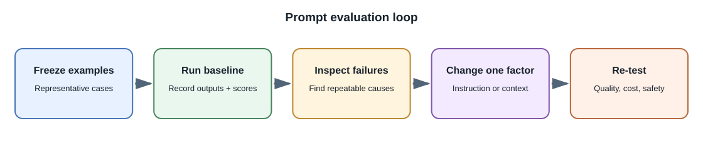

# Prompting and Structured Output

## Introduction

A **prompt** is the input and instruction context sent to a model for
inference. It may include system instructions, developer rules, user input,
conversation history, examples, retrieved information, and tool definitions.
**Prompt engineering** is the practice of designing and testing that context
for a specific task.

## Why prompt design matters

Models respond to the information and instructions in their context.
Ambiguous goals, conflicting requirements, missing data, and irrelevant
history can lead to inconsistent outputs. A clear prompt makes the task,
constraints, and expected format easier to evaluate.

## A practical prompt structure

1. **Role or task:** state what work is requested.
2. **Context:** provide only the relevant background and source material.
3. **Constraints:** define safety boundaries, audience, length, or allowed
   actions.
4. **Output format:** specify fields or a schema when predictable data is
   needed.
5. **Uncertainty behavior:** say what to do when information is missing,
   such as ask a question or return an explicit unknown.
6. **Examples:** provide representative input and output examples only when
   they clarify the desired behavior.





## Example: note summary

```text
Task: Summarize the supplied meeting notes for a project team.
Rules:
- Use only the supplied notes.
- Separate decisions, action items, and open questions.
- Include the source heading for each item.
- If an owner or date is missing, write "not specified".
Output: JSON with decisions, action_items, and open_questions arrays.
```

This prompt improves clarity, but the application must still validate JSON,
check source references, and allow correction. The instruction "use only the
notes" is not a technical security boundary.

## Structured output

When an application expects data, use a provider's structured-output or
schema-constrained feature when available. Define required fields, types,
enums, and bounds. Then validate the response on the server with an ordinary
schema validator before using it.

Do not assume JSON-looking text is valid JSON or that valid JSON is
factually correct. A schema can ensure `priority` is one of three strings;
it cannot prove that the selected priority is appropriate.

## Parameters and reproducibility

Prompts and model behavior can change with model version, provider defaults,
sampling parameters, and context. Keep prompts in version control without
embedding secrets or personal data. Record model identifiers and relevant
configuration so a test can be reproduced as closely as possible.

## Prompt injection

**Prompt injection** is untrusted input that attempts to override
instructions or influence model behavior. It can appear in user text,
documents, web pages, or tool results. The model should not be treated as an
authorization engine.

Keep sensitive operations behind application code. A model may suggest a
tool call, but the backend must validate arguments, check the user's
permissions, and constrain the operation before execution. Treat retrieved
content as data, not instructions.

## Testing prompts

Build a small set of realistic inputs, including ambiguous, malformed,
adversarial, and out-of-scope examples. Evaluate:

- whether required information is present;
- whether the model follows the requested format;
- factual support and source attribution;
- refusals and uncertainty handling;
- latency and token consumption;
- behavior after changing model or prompt versions.

Change one important prompt component at a time and compare outputs. A
single impressive example is not evidence of reliability.

## Full-stack developer perspective

Keep prompts and provider logic on the server when they contain private
instructions or access to tools. Prompt text is not a substitute for input
validation, output encoding, authorization, or rate limiting.

## Common misconceptions

- A longer prompt is not automatically a better prompt.
- Telling a model to "be accurate" does not verify its answer.
- JSON output can be syntactically valid and semantically wrong.
- A system prompt is not a secret or a hard security boundary.

## Further learning

- [OpenAI: Prompt engineering](https://platform.openai.com/docs/guides/prompt-engineering)
- [Google Gemini API: Prompting strategies](https://ai.google.dev/gemini-api/docs/prompting-strategies)
- [OWASP Top 10 for LLM Applications](https://genai.owasp.org/llm-top-10/)
