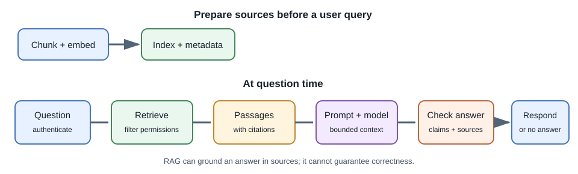
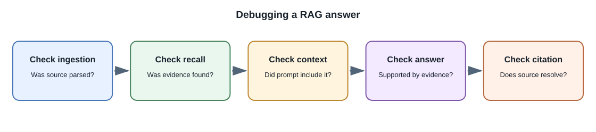

# Retrieval-Augmented Generation (RAG)

## Introduction

**Retrieval-augmented generation (RAG)** is an application pattern that
retrieves relevant external information and gives it to a generative model
as context for a response. The model remains pretrained; RAG does not update
its weights.

RAG is useful when answers should use organization documents, personal
notes, or information that changes more often than a model's training
cycle. It can improve grounding, but it does not guarantee correctness.

## Why use RAG?

A general model may not know private or recent content. Fine-tuning is
usually not the right way to store a changing document library: updated
facts would require another training process, and the model may still not
reliably recall a specific fact. RAG retrieves candidate facts at request
time, making sources available to the model and application.

## RAG pipeline

### Indexing time

1. Collect permitted documents and record their owner, tenant, source, and
   version.
2. Extract text while preserving useful structure such as headings, pages,
   or timestamps.
3. Split text into chunks and generate embeddings.
4. Store chunks, vectors, metadata, and stable source references in a
   searchable index.
5. Re-index or remove derived content when the source changes or is deleted.

### Query time

1. Authenticate the user and determine which sources they may access.
2. Rewrite or embed the query if the chosen retrieval design requires it.
3. Search using vector, keyword, or hybrid retrieval with authorization
   filters applied.
4. Rank and select a bounded set of passages.
5. Ask the model to answer using those passages and return source
   identifiers.
6. Validate the output and render citations that link to the original
   content.

## What makes RAG good or bad?

RAG has two distinct quality stages:

- **Retrieval quality:** were the useful and authorized passages found?
- **Generation quality:** did the model accurately use those passages and
  represent their limits?

If retrieval misses a relevant paragraph, a better prompt may not fix it.
If the right paragraph is present, the model can still misread it. Measure
both stages separately. Useful retrieval metrics include recall at *k* and
ranking measures; answer evaluation can check correctness, support, and
citation validity with human-reviewed examples.

## Security and access control

Documents can contain prompt injections or malicious instructions. Treat
retrieved text as untrusted data. Do not let it override system policy or
grant tools permission.

The backend must filter retrieval by the authenticated user's permissions.
If authorization is applied only after retrieval or after generation,
private content may leak through the answer, citations, logs, or cache. Keep
tenant and ownership metadata in the retrieval design and test cross-user
isolation.

## RAG versus fine-tuning

| Need | RAG | Fine-tuning |
|---|---|---|
| Use current/private documents | Often appropriate | Not a reliable document lookup mechanism |
| Provide traceable sources | Can return retrieved source references | Does not inherently provide citations |
| Change knowledge often | Update the index | Requires retraining or additional mechanisms |
| Change style or repeatable behavior | Prompting may be enough; fine-tuning can help in some cases | Often a candidate after evaluation |
| Add access control | Filter documents at retrieval time | Model weights do not enforce user-specific permissions |

The approaches can be combined, but each adds complexity. Start with the
simplest system that passes task-specific tests.

## Full-stack example: company handbook assistant

An employee asks about vacation policy. The backend checks the employee's
identity and organization, retrieves the current policy sections they may
see, and asks the model to answer only from those sections. The response
includes links and section names. If no relevant passage is found, the
assistant says it cannot answer from the available material and links to the
human HR channel.

## Common failure modes

- Chunks omit headings or context needed to interpret a paragraph.
- Old and new document versions both appear in results.
- The right passage is retrieved but truncated from the model's context.
- Search results are relevant in wording but not authoritative.
- Citations are fabricated or point to the wrong passage.
- A shared cache returns one user's retrieval results to another user.

## Developer perspective

Build a small retrieval evaluation set before adding rerankers or complex
agents. Preserve source identifiers from ingestion to UI. Log retrieval IDs
and model versions where safe, and test document updates, deletion, and
tenant isolation.

## Common misconceptions

- RAG does not retrain the model.
- RAG does not guarantee the model will follow sources.
- Vector similarity alone is not a relevance or access-control guarantee.
- Adding citations to a prompt does not prove that the rendered citation is
  real; the application must validate it against retrieved source IDs.

## Further learning

- [Lewis et al., Retrieval-Augmented Generation for Knowledge-Intensive NLP Tasks](https://arxiv.org/abs/2005.11401)
- [OpenAI: Retrieval guide](https://platform.openai.com/docs/guides/retrieval)
- [OWASP Top 10 for LLM Applications](https://genai.owasp.org/llm-top-10/)
