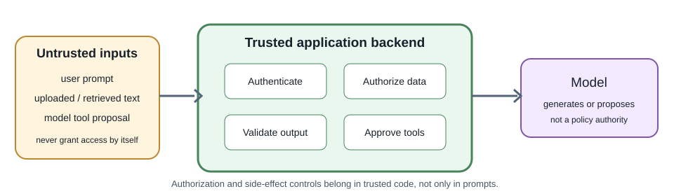
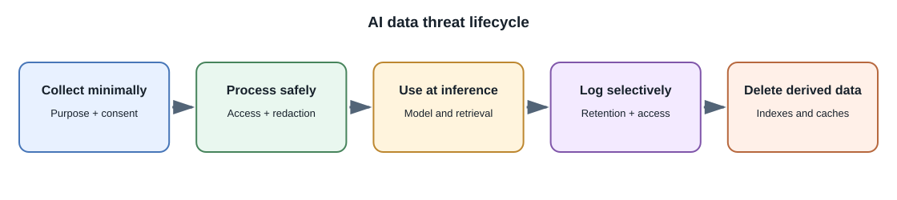

# AI Security, Privacy, and Responsible Use

## Introduction

AI security and responsible use cover risks created by model inputs,
outputs, data, tools, and deployment decisions. Existing web security still
applies: authenticate users, authorize every resource access, validate
inputs, protect secrets, and log carefully.

## Threats to consider

| Risk | Example | Important control |
|---|---|---|
| Prompt injection | A document tells the model to ignore rules or disclose secrets | Treat retrieved content as untrusted; keep permissions and actions in code |
| Sensitive-data exposure | Private prompts appear in provider logs or application telemetry | Minimize data, review provider terms, redact logs, set retention rules |
| Insecure tool use | Model requests an unauthorized database or email operation | Narrow tools, validate arguments, authorize on the server, require confirmation |
| Excessive consumption | Repeated requests create high usage costs | Authentication, quotas, rate limits, output bounds, abuse monitoring |
| Insecure output handling | Generated text is rendered as trusted HTML or SQL | Encode output, parameterize queries, validate structured results |
| Supply-chain risk | Untrusted weights or packages contain unsafe code | Use trusted sources, verify artifacts, isolate execution, review licenses |
| Data leakage between users | Retrieval or cache returns another tenant's content | Enforce ownership filters and test isolation at every layer |
| Overreliance | User acts on an incorrect generated answer | Show uncertainty and sources; use human review for consequential actions |

## Prompt injection is not solved by a magic prompt

Prompt injection exploits the fact that models process instructions and
content together. An instruction in a retrieved document may conflict with
application intent. Prompt wording can reduce some failures but is not a
security boundary.

Keep secrets out of model context. Do not rely on the model to decide
whether a user may access a record. Give the model only the data and tools
needed for the current task, and make the backend enforce permissions before
retrieval and before each action.

## Privacy and data governance

Before sending data to a provider, determine what the data contains, whether
the organization may transmit it, where it is processed, how long it is
retained, and whether it may be used for training under the applicable
contract and product settings. Do not assume provider behavior from a
consumer product's terms or another API tier.

For user-facing products, explain when AI is being used, what data is
processed, and how users can correct or delete relevant data where
applicable. Minimize collection and keep data only as long as needed.

## Output safety

Treat generated content as untrusted:

- Escape text before rendering; do not insert arbitrary model output as
  executable HTML.
- Validate structured fields against a schema and business constraints.
- Parameterize database operations.
- Do not execute generated code or shell commands automatically.
- Verify citations against source identifiers held by the application.
- Require human review before high-impact or irreversible actions.

## Responsible-use questions

For a proposed feature, ask:

1. Who benefits, and who could be harmed by an incorrect result?
2. What data was used and is the intended use permitted?
3. Can users understand, contest, or correct the result?
4. Is a deterministic or human process safer and simpler?
5. How will performance be measured across relevant groups and real usage?
6. Who owns incident response, updates, and retirement?

Requirements depend on use, jurisdiction, and impact. Consult qualified
legal, privacy, security, and domain experts for regulated or consequential
systems.

## Full-stack developer perspective

AI features inherit the application's threat model and add new untrusted
inputs and outputs. Threat-model the data path from browser to backend,
retrieval store, provider, tools, logs, and user-visible result.

## Common misconceptions

- A system prompt cannot replace access control.
- HTTPS protects data in transit but does not decide provider retention.
- A private model is not automatically unbiased, safe, or legally compliant.
- Human review is effective only when reviewers have enough context and
  authority to correct the result.

## Further learning

- [OWASP Top 10 for LLM Applications](https://genai.owasp.org/llm-top-10/)
- [NIST AI Risk Management Framework](https://www.nist.gov/itl/ai-risk-management-framework)
- [NIST Privacy Framework](https://www.nist.gov/privacy-framework)
- [OWASP Secrets Management Cheat Sheet](https://cheatsheetseries.owasp.org/cheatsheets/Secrets_Management_Cheat_Sheet.html)
