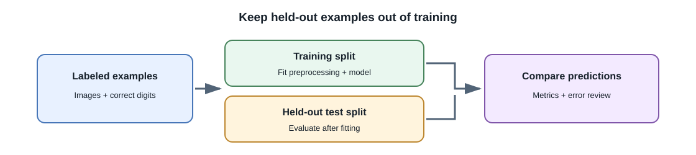
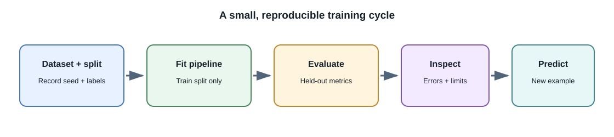

# Small-Scale Model Training Walkthrough

## Introduction

This guided exercise trains a small image classifier on scikit-learn's
built-in handwritten-digits dataset. Each example is an 8-by-8 grayscale
image labelled with a digit from 0 to 9. The goal is to practice a real
training workflow—load data, split it, fit a model, evaluate it, and make a
prediction—on a dataset that is small enough for a laptop.

This is **not** training an LLM, training a foundation model, or a deep
computer-vision model. It demonstrates classical supervised learning and
provides a safe starting point before larger frameworks and datasets.





## 1. Prepare the environment

Use a virtual environment and install scikit-learn:

```powershell
python -m venv .venv
.\.venv\Scripts\Activate.ps1
python -m pip install scikit-learn
```

On macOS or Linux, activate the environment with:

```bash
source .venv/bin/activate
```

The digits dataset ships with scikit-learn, so this exercise does not need
to download image files. Use the dataset only for learning; check the
dataset's documentation and terms before reusing data in another context.

## 2. Load examples and create a held-out split

Each image is represented as 64 pixel values (an 8-by-8 grid flattened into
a vector), and its label is the correct digit. Keep test examples out of
training and model-selection decisions.

```python
from sklearn.datasets import load_digits
from sklearn.model_selection import train_test_split

digits = load_digits()
X_train, X_test, y_train, y_test = train_test_split(
    digits.data,
    digits.target,
    test_size=0.25,
    random_state=42,
    stratify=digits.target,
)

print(X_train.shape, X_test.shape)
```

`stratify` keeps the class proportions similar in both splits.
`random_state` makes this split reproducible. In a real image project,
split by subject, source, or time when near-duplicate images could
otherwise appear in both sets.

## 3. Fit a baseline classifier

Use a pipeline so feature scaling is learned from the training data and
then applied consistently. `StandardScaler` is fitted inside the pipeline,
preventing test-set values from leaking into preprocessing.

```python
from sklearn.pipeline import make_pipeline
from sklearn.preprocessing import StandardScaler
from sklearn.svm import SVC

model = make_pipeline(
    StandardScaler(),
    SVC(kernel="rbf", C=5),
)
model.fit(X_train, y_train)
```

`fit` learns parameters from the training split. The support vector
classifier (SVC) is a classical ML method; it does not use a CNN or
transformer.

## 4. Evaluate on examples kept aside

```python
from sklearn.metrics import accuracy_score, classification_report

predictions = model.predict(X_test)
print(f"test accuracy: {accuracy_score(y_test, predictions):.3f}")
print(classification_report(y_test, predictions))
```

Accuracy reports the fraction of correct predictions; the classification
report adds per-class precision, recall, and F1. The exact score can vary
with library versions and split choices. Do not treat this small benchmark
as evidence that the classifier will work on phone photos, different
handwriting, or other real-world images.

Review the confusion matrix to see which digits are mixed up:

```python
from sklearn.metrics import confusion_matrix

print(confusion_matrix(y_test, predictions))
```

Rows represent true classes and columns predicted classes. Inspect
off-diagonal values to identify errors; a single aggregate accuracy number
does not explain them.

## 5. Run inference on one held-out image

```python
sample = X_test[0].reshape(1, -1)
predicted_digit = model.predict(sample)[0]
actual_digit = y_test[0]
print(f"predicted={predicted_digit}, actual={actual_digit}")
```

The model receives the same flattened numeric representation used during
training. For a production image task, image decoding and preprocessing
must match the model's expected input contract; see
[Practical Computer Vision](computer-vision.md).

## 6. Change one thing and compare

Choose one controlled change, such as `C=1` instead of `C=5`, and rerun
the same split. Record the model configuration, test metrics, and any
important error patterns. Do not repeatedly choose settings based on the
test set; use a validation split for model selection and retain a final
test set for an unbiased estimate.

Useful next experiments:

- Compare against a simple baseline such as predicting the most frequent
  training label.
- Inspect errors by class instead of tuning only for overall accuracy.
- Try a different permitted classifier and keep the split fixed.
- Save the chosen pipeline with a documented, compatible serialization
  method only after understanding the security implications of loading
  model artifacts.
- Move to a small transfer-learning image example only after this workflow
  is clear; it will require a deep-learning framework, more dependencies,
  and typically pretrained weights.

## What this exercise teaches

- **Data preparation:** inputs, labels, class-balanced splits, and
  reproducibility.
- **Training:** fitting a model on training examples rather than asking a
  pretrained model to answer a prompt.
- **Evaluation:** using held-out examples and per-class metrics.
- **Inference:** applying the trained pipeline to a new example using the
  same representation.
- **Limitations:** a successful toy experiment is not a production-ready
  vision system or evidence of broad generalization.

For dataset governance, more complex training, and fine-tuning choices,
continue with [AI Data Preparation](ai-data-preparation-and-governance.md),
[Training Models](training-models.md), and [Fine-Tuning](fine-tuning.md).

## Further learning

- [scikit-learn: Recognizing handwritten digits](https://scikit-learn.org/stable/auto_examples/classification/plot_digits_classification.html)
- [scikit-learn: Cross-validation](https://scikit-learn.org/stable/modules/cross_validation.html)
- [PyTorch: Transfer learning for computer vision](https://pytorch.org/tutorials/beginner/transfer_learning_tutorial.html)
