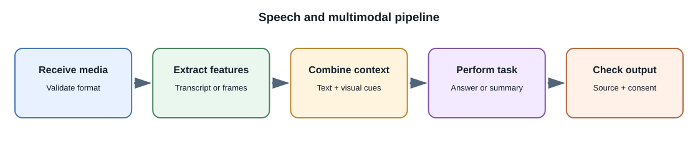
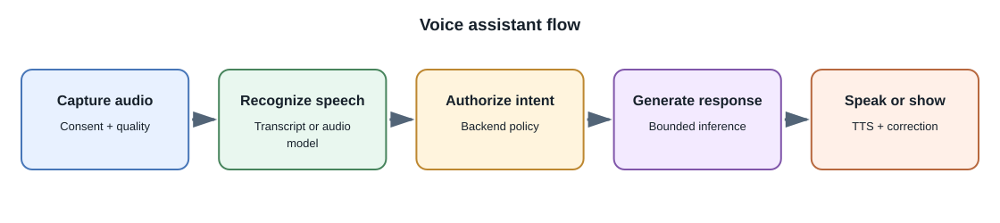

# Speech and Multimodal AI

## Introduction

**Multimodal AI** works with more than one type of input or output, such as
text, images, audio, and video. A system may use one model that accepts
several modalities or compose specialized models into a pipeline. The
supported media, languages, duration, resolution, and interaction patterns
are specific to each model.

## Speech tasks

| Task | Input | Output | Typical use |
|---|---|---|---|
| Automatic speech recognition (ASR) | Audio waveform or encoded audio | Text transcript | Captions, voice notes, searchable meetings |
| Speech translation | Audio or transcript in one language | Text or audio in another language | Accessible multilingual communication |
| Text-to-speech (TTS) | Text plus voice settings | Generated audio | Narration, accessibility, voice interfaces |
| Speaker diarization | Audio | Speaker labels and time segments | Meeting summaries and speaker-aware transcripts |
| Speech understanding | Audio, sometimes with text context | Answer, labels, or action candidates | Voice assistants and audio analysis |

Transcription can confuse similar words, names, accents, background sounds,
and overlapping speakers. Preserve timestamps or confidence information
when the workflow needs traceability, and let users correct transcripts.

## Images and video

Vision models can classify or describe images, extract text with OCR,
answer questions about a chart, or compare visual content. Video adds time:
systems may sample frames, process audio separately, or use a model that
accepts video directly. Frame sampling can miss brief events, and large
media can exceed request limits.

For production uploads, validate media server-side, limit size and duration,
remove or protect sensitive metadata where appropriate, and use background
jobs for long-running extraction. Keep the original media and derived
transcripts, captions, and embeddings under the same authorization and
retention policy.

## Building a multimodal workflow

1. Identify the user's task and which modalities are truly necessary.
2. Obtain consent and validate file format, size, duration, and policy.
3. Preprocess safely; record transformations such as resizing or audio
   resampling.
4. Call a model with a bounded request and clear output contract.
5. Validate the response and link it to source media, timestamps, or
   regions when possible.
6. Present uncertainty and allow correction, deletion, or human review.

## Evaluation

Text-only benchmarks are insufficient for many media tasks. Evaluate
transcription word errors and names, timestamp alignment, image-text
grounding, speaker attribution, accessibility, and performance across
conditions relevant to the product. Review privacy and consent requirements
for voice and face data.

## Common misconceptions

- A multimodal model does not necessarily support every modality in both
  directions.
- A video summary can miss events between sampled frames.
- A transcript may be fluent but still misrecognize a name or number.
- Voice cloning and face synthesis require stronger consent and abuse
  controls than ordinary text generation.

## Related lessons

- [Model Types and Capabilities](model-types-and-capabilities.md)
- [Generative Models and Diffusion](generative-models-and-diffusion.md)
- [Building AI Features](building-ai-applications.md)

## Further learning

- [OpenAI Audio guide](https://platform.openai.com/docs/guides/audio)
- [Google Gemini API documentation](https://ai.google.dev/gemini-api/docs)
- [W3C Web Accessibility Initiative](https://www.w3.org/WAI/)
