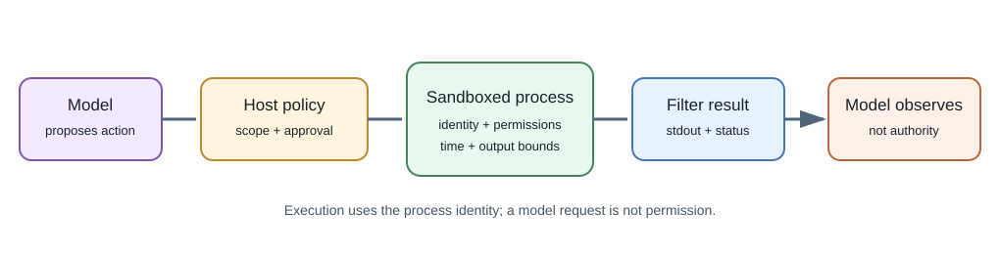
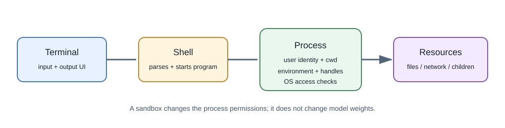

# Terminal Tools and Operating-System Access in AI Applications

## Introduction

Some AI products can request that a host run commands or operate on files.
The language model does not inherently possess a terminal or direct
operating-system access. A surrounding **host**, **agent runtime**, or
**tool executor** receives the model's structured request and may execute
an approved operation using the permissions of its process.





## What a terminal and shell do

A **terminal** is an interface for text input and output. A **shell** such
as PowerShell, Bash, or Zsh parses commands and starts programs. A command
can inspect files, create or modify data, start processes, or access
networks depending on the user's permissions and the execution environment.

An AI coding assistant may have separate tools for:

- reading or searching project files;
- applying a patch through an editor API;
- running a selected test or build command;
- calling a version-control or browser API;
- starting an approved shell command.

These are different capabilities. A file-editing tool can be narrower than
an unrestricted shell. The host decides which tools exist and what approval
is needed.

## Safe, read-only command examples

Search source code without running it:

```powershell
# Search for TODO markers in Markdown files.
rg -n "TODO" docs -g "*.md"

# List a focused directory.
Get-ChildItem .\docs\11-ai-and-machine-learning

# Inspect pending Git changes.
git status --short
```

In Bash, the equivalents commonly include `rg -n "TODO" docs -g '*.md'`,
`find docs -maxdepth 2 -type f`, and `git status --short`. Prefer a
project-aware search tool such as `rg` for source searches. A broad command
like `grep -R` can traverse more directories than intended; specify the
target path and file filter.

## How an AI command request should work

1. The model emits a structured tool request, for example a command string
   or a named operation and arguments.
2. The host checks whether that tool is enabled for this task and whether
   the request needs user confirmation.
3. A policy layer checks working directory, permitted commands, arguments,
   network access, and time or output budgets.
4. The operating system starts a process under an identity with specific
   filesystem, process, and network permissions.
5. The host captures standard output, standard error, and exit status; it
   truncates or filters output before returning it to the model.
6. The model can interpret the result, but the host must verify subsequent
   actions independently.

## Process and operating-system boundaries

When a command runs, it normally inherits an execution context: user or
service identity, current directory, environment variables, open handles,
and a set of OS permissions. It can start child processes and may access
files or services allowed to that identity. Containers and sandboxes add
isolation boundaries, but their strength depends on configuration and
host-kernel protections.

If a command can write to a project, it can alter source code. If it can
access credentials, it may read them. If it can use the network, it may
send or fetch data. If it can install packages, it can execute package
scripts or load additional code. Treat these permissions as explicit
capabilities, not as harmless defaults.

## Risk tiers and approval

| Operation | Typical risk | Safer approach |
|---|---|---|
| List files or search selected source | Lower, usually read-only | Restrict paths and avoid secrets or generated directories |
| Run a known test or formatter | Moderate; code may execute | Use the project script, inspect the command, constrain time and scope |
| Edit or delete files | Changes persistent state | Show a diff, limit paths, require confirmation for broad changes |
| Install dependencies or execute downloaded code | Supply-chain and system changes | Review package and lockfile, isolate environment, ask before install |
| Access credentials or external services | Data and account impact | Use least privilege, secret redaction, explicit authorization |
| Run with administrator/root privileges | Broad OS-level impact | Avoid unless essential; require explicit informed approval and audit |

Do not treat a model's explanation as proof that a command is safe. Parse
arguments, use allowlists where feasible, and prefer structured operations
over concatenating user text into a shell command.

## Safer process execution in application code

If an application must start a fixed local utility, pass an argument list
instead of constructing a shell command from user input:

```python
import subprocess

result = subprocess.run(
    ["rg", "-n", "TODO", "docs"],
    cwd=".",
    capture_output=True,
    text=True,
    timeout=5,
    check=False,
)
print(result.returncode)
print(result.stdout[:2000])
```

This example runs a fixed search. Argument arrays reduce shell
interpretation risk but are not a complete sandbox: validate paths, restrict
permissions, set output and time limits, and do not pass untrusted values
as unrestricted options.

## How this differs from MCP

MCP is a protocol for connecting an AI host to a server that exposes
capabilities such as tools or resources. A server may itself call a
terminal or operating-system API, but the protocol does not grant that
permission automatically. The server process still has OS-level
permissions, and the host still needs to decide which capabilities users
may approve. See [MCP and Agent Integrations](mcp-and-agent-integrations.md).

## Developer perspective

For an AI coding assistant, allow only the project directories and tasks
needed. Separate read, write, network, and process-execution permissions;
require review before destructive or external effects; keep credentials out
of command output; and show exactly what was run and what files changed.

## Further learning

- [Python `subprocess` documentation](https://docs.python.org/3/library/subprocess.html)
- [Microsoft PowerShell security features](https://learn.microsoft.com/powershell/scripting/security/security-features)
- [NIST Application Container Security Guide](https://csrc.nist.gov/pubs/sp/800/190/final)
- [MCP security best practices](https://modelcontextprotocol.io/specification/2026-07-28/basic/security_best_practices)
