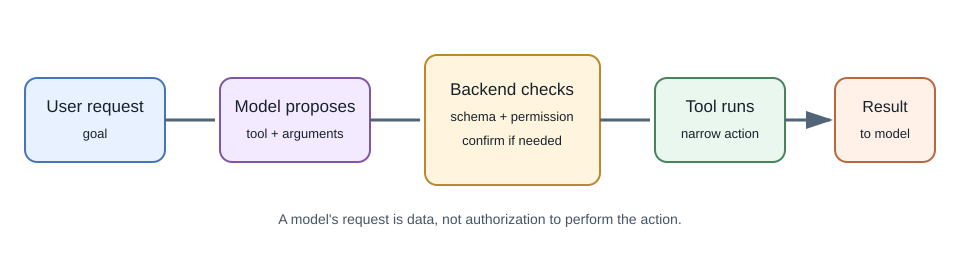
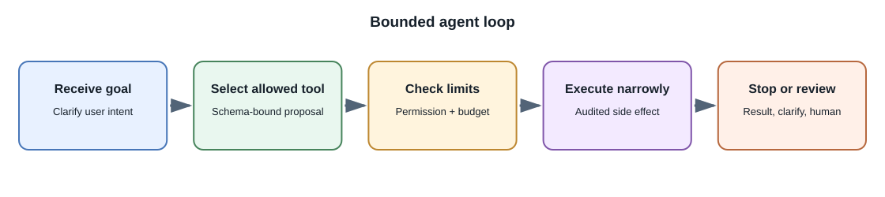

# Tool Calling and AI Agents

## Introduction

**Tool calling** lets a model request that an application run a named
operation with structured arguments. The model does not directly execute
the operation; the surrounding application receives the request, validates
it, decides whether it is allowed, and returns a result.

An **agent** is a system that uses a model to choose or sequence actions
toward a goal, often in a loop of planning, tool calls, observations, and
further decisions. The term is used broadly, so describe the actual
workflow rather than relying on the label.

## Why use tools?

A language model alone cannot reliably read a live account balance, query a
private database, send an email, or calculate an exact value. Tools connect
the model to controlled application capabilities and current information.

## How an assistant can fetch a browser URL

A model does not automatically open a browser or fetch arbitrary URLs. A
product can provide a controlled browsing tool or retrieval service. The
model may request that tool; the application or a dedicated fetcher makes
the network request and returns selected content to the model.

A safe, simplified flow is:

1. The user asks about a page or provides a URL.
2. The backend validates the URL and checks that fetching it is permitted.
3. A restricted fetcher requests the page, follows an allowed redirect
   policy, and extracts bounded text or metadata.
4. The application returns the fetched result and its URL to the model as
   untrusted context.
5. The answer can link to the fetched page, while the UI distinguishes
   fetched source content from the model's explanation.

Some products instead use a search provider or an isolated browser service;
others have no browsing capability at all. The configured tool and
provider documentation determine what is actually possible. A URL in a
prompt by itself is not evidence that the page was visited or is current.

There is also a difference between fetching a page and operating a browser.
A basic fetcher requests a URL and extracts a response; it may not see
content that only appears after JavaScript runs or after a user signs in.
An isolated browser can render interactive pages, but it introduces more
powerful capabilities and risks. Do not reuse a user's browser session or
send credentials to a page unless the product explicitly requires it and
has a secure, consent-based design.

Fetching user-supplied URLs creates server-side request forgery (SSRF) and
content risks. Block loopback, private, link-local, and otherwise
disallowed network destinations; re-check every redirect and resolved
address; limit response size and time; restrict schemes; and avoid sending
cookies or internal credentials. Do not treat page instructions as trusted
system instructions. For many applications, a vetted search or document
connector is safer than an unrestricted URL-fetch tool.

## Tool-calling flow

1. The application provides the model with a bounded list of tools and their
   input schemas.
2. The model may return a tool-call request instead of a final response.
3. The backend validates the tool name, arguments, user identity, and
   authorization.
4. The backend runs only the approved operation and returns a limited
   result.
5. The model may use that result to form a response or request another
   allowed step.
6. The application enforces a maximum number of steps and a time or cost
   budget.

## Example: order status

The model may request `get_order_status({orderId: "..."})`. The backend
must check that the authenticated user owns that order before querying it.
The model's possession of an order ID is not authorization. Return only the
necessary status fields, not the full customer record.

## Keep tools narrow and safe

- Use specific operations such as `get_my_recent_orders`, not an unrestricted
  `run_sql` or shell command.
- Validate arguments against a schema and reject unknown fields.
- Derive user identity and tenant scope from the authenticated server
  context, not model-generated arguments.
- Apply rate limits, timeouts, and result-size bounds.
- Make writes idempotent where possible and require user confirmation for
  meaningful external actions.
- Record an audit trail without storing secrets or excessive personal data.
- Treat tool results and retrieved content as untrusted input.

Never let a model generate code that your server blindly executes with broad
permissions. Put the operation behind a small, reviewed application
function.

## Agent loop and stopping

A simple agent loop has a request, model decision, tool execution, tool
result, and another model decision. It should have explicit stopping
conditions: a final answer, a maximum step count, a timeout, a permission
failure, or a required human approval. Without bounds, loops can consume
cost, repeat actions, or fail to make progress.

For multi-step work, store workflow state explicitly and make it resumable
where necessary. Do not rely on a very long model conversation as the only
record of a business process.

## When not to use an agent

Use ordinary application code when the workflow is deterministic, short,
and security-sensitive. A fixed sequence of API calls is often easier to
test than an agent that chooses each step. Introduce agent autonomy only
when flexible choice measurably improves the task and can be bounded.

## Real-world examples

- A shopping assistant can search a catalog, but checkout should show the
  exact cart and require the user's explicit confirmation.
- A support assistant can retrieve a ticket and draft a reply, while a
  human approves sending it.
- A developer assistant can search code and propose a patch, but tests and
  review should validate the change.

## Developer perspective

Separate model decision-making from tool execution. Test invalid arguments,
permission failures, duplicate calls, timeouts, prompt injection, and
unavailable tools. Monitor cost per completed task, not only the number of
successful model responses.

## Common misconceptions

- A tool call in a model response is a request, not proof it ran.
- An agent cannot safely grant itself permissions.
- More autonomy does not automatically improve usefulness.
- A successful model answer does not mean a requested tool action succeeded.

## Further learning

- [OpenAI: Function calling](https://platform.openai.com/docs/guides/function-calling)
- [Google Gemini API: Function calling](https://ai.google.dev/gemini-api/docs/function-calling)
- [OWASP Top 10 for LLM Applications](https://genai.owasp.org/llm-top-10/)
