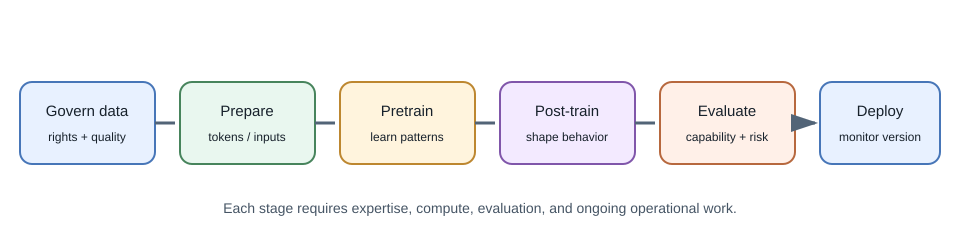
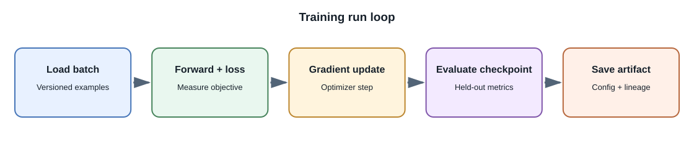

# Training Models

## Introduction

**Training** adjusts model parameters using data and an objective. Training
a model from scratch starts with initialized parameters rather than a
pretrained base. For a modern foundation model, this requires a large,
carefully governed dataset, substantial compute, distributed training
expertise, extensive evaluation, and ongoing operations.

Building an AI product does not require training a foundation model. Most
full-stack developers use an existing model through a hosted API, run an
available model locally, or fine-tune a base model for a narrow need.

## Training stages in broad terms

1. **Data collection and governance:** establish provenance, rights,
   consent, privacy handling, quality filters, and retention.
2. **Tokenization or input preparation:** convert text, images, audio, or
   other data into model-compatible representations.
3. **Pretraining:** optimize a broad objective over large data. Language
   models commonly learn to predict tokens from context.
4. **Post-training:** adapt behavior using instruction examples,
   preferences, or other supervised and preference-based methods.
5. **Evaluation and red-teaming:** test capabilities, limitations,
   robustness, safety, and policy requirements.
6. **Deployment and monitoring:** serve inference, track drift and
   incidents, and update or retire the model as evidence requires.

This is a simplified map. Real training pipelines can have many more stages
and specialized procedures.

## Pretraining objective and data

An objective specifies what the training process optimizes. A next-token
objective teaches a language model to predict the next token in training
sequences. That objective does not directly guarantee factual accuracy,
instruction following, or safe behavior; those properties depend on data,
training stages, and evaluations.

Data quality, coverage, duplication, licensing, representation, and
contamination all matter. Removing personal or copyrighted content can
involve legal and technical questions that depend on jurisdiction and use.
Document decisions and obtain appropriate expert review rather than
assuming data is permitted because it is publicly reachable.

### Post-training and alignment

A pretrained next-token model is commonly adapted into a more useful
assistant through one or more post-training stages. **Instruction
fine-tuning** uses examples of requests and desired responses. Preference
methods compare candidate outputs or optimize against preference data.
**Reinforcement learning from human feedback (RLHF)** is one family of
approaches that uses human preference signals in an optimization process;
other techniques, including direct preference optimization, use different
training objectives.

These stages shape behavior according to the examples and objective.
They do not guarantee that the model follows every instruction, refuses
every unsafe request, or gives factual answers. Test capabilities and
failure modes independently from the training objective.

### Training on domain-specific material

When an organization says it wants to "train an LLM on its data," clarify
the desired result:

- To make a model more familiar with domain language and patterns, a team
  may consider continued pretraining on permitted domain text.
- To make it follow a repeatable task format, supervised fine-tuning on
  curated examples may be relevant.
- To prefer certain kinds of responses, preference-based post-training may
  be considered.
- To answer questions from a changing document collection with traceable
  sources, retrieval-augmented generation is usually the more direct
  application pattern.

These are not interchangeable. Training changes learned parameters and
requires data preparation, compute, evaluation, and lifecycle management.
Retrieval selects source content at request time and can apply user-level
permissions, but requires a secure, current retrieval system. Neither
approach makes an answer automatically correct. See
[Fine-Tuning](fine-tuning.md) for a comparison of the training options and
their limitations.

### Training signals and losses

A **loss** is a numeric objective used to guide parameter updates. For a
next-token language model, cross-entropy loss penalizes assigning low
probability to the observed next token in training data. **Perplexity** is
derived from average token loss and can compare language-model prediction
on compatible data, but it does not directly measure user usefulness,
truth, safety, or reasoning.

Training pipelines often process data in batches over many steps. Very
large jobs distribute work across accelerators and must manage gradient
communication, checkpointing, numerical precision, and recovery from
hardware or network failures.

## Compute and infrastructure

Large training jobs may use multiple accelerators and distributed systems.
Teams manage throughput, network communication, storage, checkpoints,
numerical stability, failures, and reproducibility. The final model also
requires an inference system with capacity planning, safety controls, and
monitoring.

Training cost is not only the accelerator bill. It includes data
preparation, engineering, evaluation, energy, storage, deployment, incident
response, and ongoing model maintenance.

Common scaling strategies include **data parallelism**, where workers
process different batches and synchronize updates; **tensor or model
parallelism**, where layers or matrix operations are split across devices;
and **pipeline parallelism**, where different model stages run on different
workers. Distributed strategies introduce communication overhead and
failure modes, so they are not automatically faster for small experiments.

## When training from scratch might make sense

Potential reasons include research into new architectures or objectives, a
domain with uniquely valuable and legally usable data, or strategic needs
that cannot be met through available models. Even then, teams often compare
against pretrained or open-weight baselines first.

For an individual full-stack developer, a useful learning exercise is to
train a small model or fine-tune a small open-weight model on a permitted
toy dataset. This teaches the pipeline without claiming to reproduce a
production-scale foundation model.

## Options for developers

| Goal | Practical approach |
|---|---|
| Add chat or summarization | Hosted inference API or a local pretrained model |
| Keep experimentation on a laptop | Small model with a compatible local runner |
| Search a changing document library | Embeddings and RAG |
| Make output style or task behavior more consistent | Prompt evaluation first, then consider fine-tuning |
| Learn training concepts | Train a small model on a public, suitable educational dataset |
| Build a new frontier-scale model | Requires an organization, research expertise, major compute, data governance, and safety process |

## Developer perspective

Treat model training and application engineering as related but distinct
disciplines. A full-stack product can create real value through secure APIs,
retrieval, user experience, evaluation, and workflow design without owning
the base model.

## Common misconceptions

- Training a model from scratch is not the same as calling a model API.
- Fine-tuning is not the same as pretraining.
- Training loss alone does not measure product usefulness or safety.
- A model trained on public web data is not automatically licensed for every
  downstream use.

## Further learning

- [Stanford CS336: Language Modeling from Scratch](https://stanford-cs336.github.io/)
- [Hugging Face: Training a causal language model from scratch](https://huggingface.co/learn/llm-course/chapter7/6)
- [NIST AI Risk Management Framework](https://www.nist.gov/itl/ai-risk-management-framework)
